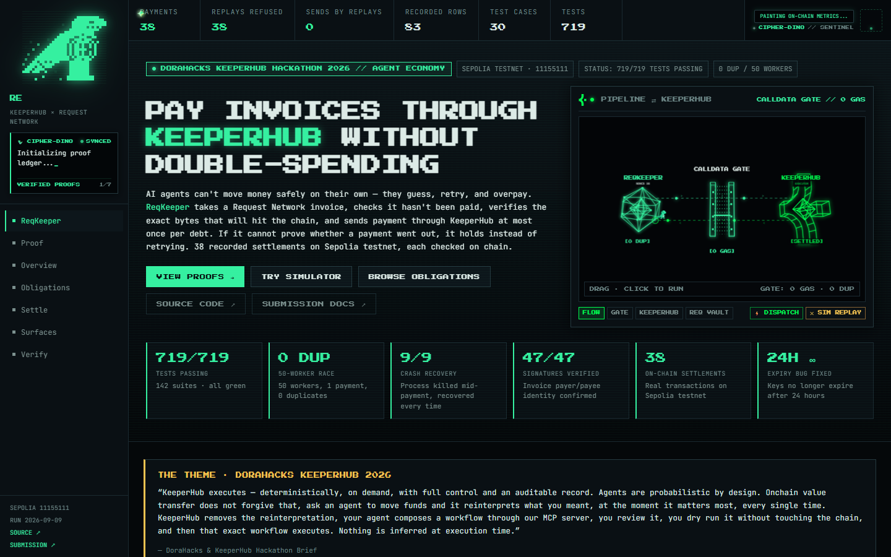
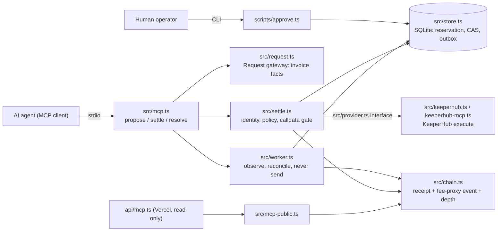

# ReqKeeper

[](https://github.com/vaibhav4046/reqkeeper/actions/workflows/ci.yml)

**At most one payment per debt. Settlement of Request Network obligations through KeeperHub that holds what it cannot prove.**

An idempotent payment gate between an AI agent and the chain: the agent proposes, a human
approves, and ReqKeeper pays a Request Network invoice through KeeperHub at most once, even
across retries, crashes and racing processes. Sepolia testnet only. Built as an entry to the
DoraHacks KeeperHub hackathon (submissions closed 18 Sep 2026).

[](https://reqkeeper.vercel.app)

*The live console at <https://reqkeeper.vercel.app>, captured with Playwright at 1440x900.*

### What this demonstrates

- **An MCP tool surface an agent cannot use to spend on its own.** `propose_payment`,
  `settle_obligation` and `resolve_pending` ([`src/mcp.ts`](src/mcp.ts)) take no approval
  argument; approval is written by a human through a separate CLI
  ([`scripts/approve.ts`](scripts/approve.ts)) and bound to a plan hash. The hosted
  `/api/mcp` surface is read-only and does not import the store or the payment provider.
- **Exactly-once side effects under retries, crashes and concurrency.** The obligation, not
  the API call, is the idempotency unit: deterministic keys ([`src/identity.ts`](src/identity.ts)),
  SQLite unique constraints, compare-and-set, leases with fencing and a transactional outbox
  ([`src/store.ts`](src/store.ts)). Exercised by a 50-process race and a 9-checkpoint crash
  test that run in CI.
- **Evidence that is re-derived, not trusted.** Settlement is decided from an independently
  read receipt plus the fee-proxy event ([`src/chain.ts`](src/chain.ts)), and
  `npm run verify:all` recomputes every published number from rows and from the public
  Sepolia chain, with no credentials.

### Quickstart (no API key needed)

Requires Node 24 (`--experimental-strip-types` and `node:sqlite`).

```bash
git clone https://github.com/vaibhav4046/reqkeeper && cd reqkeeper
npm ci                 # typescript, @types/node, playwright (only tsc is needed for CI)
npm test               # 719 tests; no network, no credentials
npm run typecheck
npm run race           # 50 OS processes, one obligation, one payment (fixture provider)
npm run mcp:e2e        # the MCP server over stdio: propose, human approve, settle once, replay
                       #   (fixture provider, but reads the public Request Sepolia gateway)
npm run verify:all     # re-checks published evidence against public Sepolia RPCs (needs internet)
```

All of the above are what [`ci.yml`](.github/workflows/ci.yml) runs. Settling a real invoice
needs a `KEEPERHUB_API_KEY` (see [Settle a real invoice](#settle-a-real-invoice)); without it,
live steps report `BLOCKED` rather than passing. `mcp:e2e` and part of `verify:all` depend on
public services (Request's Sepolia gateway, public Sepolia RPCs); when those are down, they
fail or report `BLOCKED` rather than pass.

## How it works

Agents can retry code. They must never retry money. ReqKeeper lets an agent retry a Request
invoice without paying it twice.

## 1 invoice. 50 workers. 1 payment.

```
payments broadcast              1
posts reaching the provider     1    the losing workers never got that far
deduped by idempotency key      0    KeeperHub's cache was not what stopped them
duplicate payments              0
second wave broadcasts          0    same plan, same key, after every process exited
```

Fifty independent OS processes — own process, own SQLite connection, no shared memory — settling
the same obligation against one database file, released from a barrier onto the same millisecond.
Run it: `npm run race -- --workers 50`. Artifact: [`docs/evidence/race.json`](docs/evidence/race.json).

**`posts: 1` is the number that matters.** Every worker computes the same idempotency key, because
it is derived from the obligation and the approved plan with no session input. So a run that only
showed KeeperHub refusing a duplicate key would prove KeeperHub's cache works and say nothing
about this project. The fixture counts *every* call that reaches it regardless of key and reports
the deduplicated ones separately — the losers were stopped locally, by the reservation and the
compare-and-set, before the provider was ever called.

### And once for real

The same race, three workers, against real KeeperHub and real Sepolia:
**one payment**, transaction
[`0x41b01a14…353f52`](https://sepolia.etherscan.io/tx/0x41b01a14cbdb8dd65c41eeb13285bfe9d47e1dc95990e33b0486ca5e5e353f52),
block 11,691,069. Exactly one `TransferWithReferenceAndFee` event carries that invoice's
reference. Artifact: [`docs/evidence/race-live.json`](docs/evidence/race-live.json).

Live, the payment count comes from the chain, not from a counter we own — and the two fields a
fixture can measure and a live run cannot (`postsReachingTheProvider`, `dedupedByKey`) are
recorded as `-1` rather than `0`, because `0` would read as the strongest claim on the page and
this run cannot make it.

### Both KeeperHub surfaces, both with money behind them

38 settlements through the REST direct-execution API, and **3 through KeeperHub's own MCP
server**. The difference in what those two sets evidence is worth stating: every REST row carries
a transaction hash that `verify:all` re-derives from the chain, but none carries a KeeperHub
execution id, so the transport for those is a fact about how that harness ran rather than
something each row states. The MCP rows below carry one each — `execute_contract_call` with `simulate: true` first, then with `idempotency_key`, then
`get_direct_execution_status` called once for each execution id. That status is recorded, not
trusted: settlement is decided by an independently read receipt and the fee-proxy event for the
same transaction and amount. Each MCP row carries the KeeperHub execution id that produced it:

| execution id | transaction | block |
|---|---|---|
| `a8h3pjg9wymv0b84xllla` | [`0xe02fd64c…`](https://sepolia.etherscan.io/tx/0xe02fd64ced29c8e147817077c66eeac6b71b23a629dac6a3f33d73fcd8959119) | 11,691,257 |
| `wft98bw4s4jzm02ucr21b` | [`0xfe4b0168…`](https://sepolia.etherscan.io/tx/0xfe4b0168d7add3aeeae73a421f0821fa6aab789756960da11f1aeab015a7a0b9) | 11,691,260 |
| `1i5q3nmtdwx5wnw8paami` | [`0xf206bbaa…`](https://sepolia.etherscan.io/tx/0xf206bbaa9e25309b4c12643dda998b360014136f4a9bc911bc92d70a769bc940) | 11,691,264 |

Exactly one fee-proxy event per reference, verified from the chain by `npm run verify:all`, not
read back from the file that reports them. Artifact:
[`docs/evidence/mcp-settlements.json`](docs/evidence/mcp-settlements.json).

- **Console:** <https://reqkeeper.vercel.app> · **Agent surface:** <https://reqkeeper.vercel.app/api/mcp>
- **Demo video:** no narration, every figure in it read from `docs/evidence/` at render time — [v1.0.0 release asset](https://github.com/vaibhav4046/reqkeeper/releases/tag/v1.0.0) (not committed; six cuts of it were 72 MB of this repository)
- **Every claim, with its evidence:** [`docs/TRUTH.md`](docs/TRUTH.md) (generated, never typed)
- **Every open finding:** [`hackathon/audit/STATUS.md`](hackathon/audit/STATUS.md)

## When you should not use this

If your payer can be an ERC-7710 delegator smart account, **use MetaMask's Delegation Framework
instead — it ships both of these gates on-chain and that is strictly better.** `IdEnforcer` keeps
a BitMap of spent ids, and `ExactCalldataEnforcer` requires
`keccak256(termsCallData) == keccak256(callData)`. On-chain enforcement cannot be bypassed by a
bug in software like this one.

ReqKeeper exists for the payer that has no delegation to attach a caveat to. That is not the same
as "not a smart account", and this deployment is the proof: its funding account
`0x027d54a6…` answers `eth_getCode` with `0xef0100955d84…`, an EIP-7702 delegation designator, so
it *is* code-bearing. What it does not have is an ERC-7710 delegation with enforcers on it. The
tokens move by `transferFrom` under an allowance, broadcast by KeeperHub's relayer
(`0x809d8252…`, `eth_getCode` = `0x`), so there is no caveat in the path to enforce and nothing
on-chain that can refuse a second payment. The gate has to live where the decision is made.

Read both accounts yourself, no credentials needed:

```bash
curl -s https://ethereum-sepolia-rpc.publicnode.com -H 'content-type: application/json'   -d '{"jsonrpc":"2.0","id":1,"method":"eth_getCode","params":["0x027d54a692e0e80173141777bdb847c1726fa1f3","latest"]}'
```

## Verify without credentials

```bash
npm run verify:all
```

No API key, no wallet, no `.env`. It reads local evidence and public Sepolia RPCs, imports no
provider, and cannot move money. Anything needing a credential is reported BLOCKED with the
reason — never silently skipped, never counted as a pass.

Totals are **recomputed from rows**, never read from a summary field: an artifact claiming
`duplicates: 0` in its own header proves nothing, because that is the number a bug gets wrong.
Tamper with a summary and leave its rows alone, and this exits 1 — for every number an artifact
either names after a row field or explains in its own `totalsFrom` block. A second check
then **fails the run** on any summary number that can be neither recomputed from rows nor explained
by its own artifact — a number nobody can re-derive, listed inside a passing check, is a number
that stops being looked at. Forty-three are recomputed. Five remain, all in the live race, and each
states in the artifact why it cannot come from the rows: two are the `-1` sentinel for counters
that do not exist when no fixture ran, and three are recounted from the chain rather than from
what a worker reported. Delete one of those reasons and `verify:all` exits 1.

Last CI run (23 Sep 2026): **25 ok · 0 failed · 0 blocked**, including — checked against the chain with no credentials — a
successful receipt for `0xb90a0771…` at block 11,665,983, the ERC20FeeProxy event inside that
receipt's own logs, that same payment found again by its reference through the event query
Request's own detection uses, and **47 of 47** recorded payment references re-deriving from
`last8Bytes(keccak256(lowercase(requestId + salt + paymentAddress)))`.

## Run everything else

`verify:all` and `npm test` need no install — `src/` and `scripts/` have no runtime
dependencies. `typecheck` and `build` call `tsc`, so those two want `npm install` first.

```bash
npm install           # only for typecheck and build; everything above runs without it

npm test              # 719 tests, 142 suites
npm run typecheck     # tsc --noEmit
npm run build         # console + api; the tree must stay clean afterwards
npm run gate-a        # Request <-> KeeperHub <-> Sepolia end to end
                      #   9 ok, 0 failed, 3 blocked with no credential; 10/0/2 with a
                      #   KEEPERHUB_API_KEY in .env. Blocked is never counted as a pass.
npm run race          # 50 processes, one obligation, one payment (fixture provider, no chain)
npm run crash         # kill the process at 9 checkpoints; zero duplicates (fixture, no chain)
npm run probe:mcp     # KeeperHub's own MCP server, read-only by default
npm run mcp:e2e       # the real server binary over stdin/stdout: propose, approve from a
                      #   separate process, settle once, then hammer it and pay nothing.
                      #   17 assertions, no credentials, a few seconds. If you run one
                      #   command from this list, run this one.
npm run verify:signatures
                      # every Request action of all 46 invoices: the ECDSA signer recovered
                      #   and checked against the parties the invoice names, and every anchor
                      #   bound to the transaction that stored it. Public gateway, public RPC.
```

**When something is stuck, start with `npm run resolve -- --status`** — every obligation, its
state, and one sentence on what to do next. Then
[`docs/RUNBOOK.md`](docs/RUNBOOK.md) — the
failure-mode table, the operator escape, and what each state means. It exists because a reviewer
followed this README verbatim and could not reproduce a settlement.

Nothing named `verify:*` can spend. `probe:mcp` is named for what it does, and its one call that
reaches the live platform is behind `-- --live-simulate`, because this repository's own hazard
note records that a dry run on that route can execute for real (`src/provider.ts`).

## Use it from an agent

```jsonc
// .mcp.json
{ "mcpServers": { "reqkeeper": {
    "command": "node",
    "args": ["--experimental-strip-types", "scripts/mcp-server.ts"],
    "env": { "KEEPERHUB_API_KEY": "kh_..." } } } }
```

`propose_payment(requestId, ...)` -> a human runs `approve` -> `settle_obligation` ->
`resolve_pending`.

**No tool on the agent surface can approve a payment.** Approval is written by a human at a CLI
and read back by plan hash; there is no tool that writes one. The hosted surface at `/api/mcp` is
read-only and imports no store and no provider at all — the payment tools are *absent*, not gated.

## What is read from Request, and what is sent to KeeperHub

| | Source of truth | Where |
|---|---|---|
| Invoice facts: payee, amount, fee, token, salt | Request's Sepolia gateway, unauthenticated | [`src/request.ts`](src/request.ts) |
| Payment reference | **Derived**, `last8Bytes(keccak256(lowercase(requestId + salt + paymentAddress)))` | [`src/request.ts`](src/request.ts) |
| Obligation identity | `sha256("reqkeeper.obligation.v1:" + len(ns) + ":" + ns + ":" + len(requestId) + ":" + requestId)` — length-prefixed so `("a","b:c")` and `("a:b","c")` cannot collide | [`src/identity.ts`](src/identity.ts) |
| Payment calldata | Encoded locally, proved byte-identical to KeeperHub's encoder | [`src/abi.ts`](src/abi.ts), `npm run verify:seam` |
| Execution | `POST /api/execute/contract-call` with an `Idempotency-Key` | [`src/keeperhub.ts`](src/keeperhub.ts) |
| Settlement evidence | An independently read receipt **and** the fee-proxy event for the same transaction and amount | [`src/chain.ts`](src/chain.ts) |

A caller-supplied reference that is not the one the invoice derives is `REFERENCE_MISMATCH`,
refused before any write. A payee, amount, fee or token the invoice disagrees with is
`FACTS_DISAGREE_WITH_INVOICE`. Both fail closed: an unreadable gateway is not permission to
proceed on the agent's word.

## Doesn't Request already prevent duplicate payments?

No, and the reason is specific.

Request solves **attribution**: the payment reference ties an on-chain `TransferWithReferenceAndFee`
event to an invoice, and the balance is computed from the matching events, net of refunds. That
matching is not loose — `ProxyERC20InfoRetriever` keeps only logs whose token and `to` also match
the request, and the TheGraph retriever filters on the proxy contract as well, so the reference
alone is not what Request trusts either. What Request does not solve is **submission control**. `ERC20FeeProxy.transferFromWithReferenceAndFee` is a stateless
forwarder with no uniqueness on the reference; `GET /v2/request/{id}/pay` returns calldata with no
nonce and no idempotency. A payer that retries after a timeout emits a second event, and the
invoice reads as overpaid.

Duplicate protection has to live on the payer's execution side. KeeperHub gives that side idempotent
replay — within 24 hours, per key — plus `unconfirmed` as a poll-only state, and receipts. It does
not know what a Request obligation *is*, and a fresh agent session with a fresh key is a fresh
request to it.

ReqKeeper is the seam: it makes the **obligation**, not the API call, the unit of idempotency.
The invoice is the identity — Request already ships one, and it survives a wallet change, a key
rotation, a re-import, regenerated calldata and the 24-hour expiry. We did not invent an identity
scheme.

## What it refuses, and what it costs

45 refusals in the live matrix and 23 in the fixture matrix happened before any provider write —
zero gas. Between them the rows cover a recipient off the allowlist, a debit over the cap, a fee
over its ceiling, the wrong chain, the wrong token, token decimals that disagree with policy, a
zero amount, an unrecognised fee recipient, an invoice Request already reports paid, mutated
calldata, a payment step pointed at another contract, calldata carrying somebody else's payment
reference, a selector the provider does not allow, no human decision yet, a reviewer's rejection,
an approval older than the window it authorises, facts that changed between approval and dispatch,
a rival plan already holding the obligation, a provider whose outcome is unknown, and a replay of
something already settled or already dispatched.

Full matrix in [`docs/refusals.json`](docs/refusals.json) (FIXTURE) and
[`docs/refusals-live.json`](docs/refusals-live.json) (LIVE and RECORDED).

Three defences in this system have no row in either file, and are named here rather than implied
by them: a foreign log carrying a public payment reference
(`test/log-matching.test.ts`, `test/conflict-review.test.ts`), a wrong-chain RPC
(`src/chain.ts#assertChainId`, `test/provider-faults.test.ts`), and a receipt whose own logs do not
contain the payment (`test/receipt-evidence.test.ts`). They are covered by tests, not by the
matrices, and the difference is the point of saying so.

The invariant, stated plainly: **the system may be temporarily uncertain; it never resolves
uncertainty by paying again.** Crash it at any of 9 checkpoints and it converges or stays
honestly open — never duplicates. `npm run crash`.

## Settle a real invoice

```bash
cp .env.example .env   # KEEPERHUB_API_KEY is the only credential the settle path needs
cd tools/invoice && pnpm install && pnpm run create && cd ../..   # the invoice (docs/RUNBOOK.md §2)
npm run gate-a         # prove the three systems line up before spending anything
npm run settle:live    # proposes, prints the plan hash, stops at AWAITING_APPROVAL
npm run approve -- --requestId <id> --reference <ref> --payee <addr>                    --amount <baseUnits> --max <baseUnits> --approver you@example.com
npm run settle:live    # a decision exists for this plan now; it dispatches once
npm run resolve        # drain the outbox; depth is checked before SETTLED
```

Sepolia only. Mainnet chain ids are refused in code, not in prose.

## Limitations

Testnet only. The recorded live run is a single payee. The token allowance was granted out of
band. The 24-hour key expiry is covered by a fixture test, not observed live. Settlement requires
a minimum confirmation depth (default 2) but **nothing re-checks after settlement** — the honest
phrase is "confirmed at a stated depth", never "final". The race proves the reservation and the
compare-and-set across real processes against a counting fixture; it is not a live-money run. The
38 recorded settlements predate several of the gates they sit alongside, and are not evidence
those gates work.

Everything still open, including the awkward parts, is in
[`hackathon/audit/STATUS.md`](hackathon/audit/STATUS.md) — four adversarial audits with runnable
probes, and what each one found that is *not* yet fixed.

## Architecture



`src/store.ts` is the durable spine: `UNIQUE(namespace, request_id)`, a partial
`UNIQUE(payment_reference)`, `UNIQUE(plan_hash, step_index)`, a transactional outbox, leases with
fencing generations, and a hash-chained audit trail.

## Development

Node 24, zero dependencies in `src/`. `node --experimental-strip-types`, `node --test`, SQLite via
`node:sqlite`. `npm test && npm run typecheck && npm run build` before every push.

## Licence

MIT.
